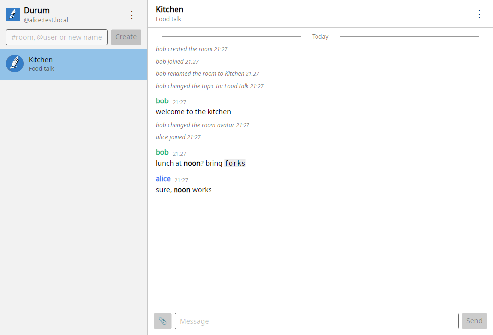

# Getting started

The Uniform.Matrix app for Windows and Linux: rooms, messages, files and end-to-end encryption in a graphical window. In narrow windows it shows one pane at a time.



> [!NOTE]
> The app is in early development. It covers everyday chatting and encryption; notifications on Windows are still to come.

## Requirements

- Windows 10 or later, or Linux
- An account on a Matrix homeserver, for example `@alice:matrix.org`

## Install

### Windows

Download `uniform-matrix-desktop-<version>-win-x64.zip` (or `win-arm64`) from the [releases](https://github.com/tagcode/Uniform.Matrix/releases) and unpack it anywhere; the `docs` folder in it has this guide (open `docs/index.html`). Then run `Uniform.Matrix.exe`. Windows may warn that the app is from an unknown publisher, because it is not signed yet; choose *More info → Run anyway*.

### Linux

Download `uniform-matrix-desktop-<version>-linux-x64.tar.gz` (or `linux-arm64`), unpack it and run the app:

```bash
tar -xzf uniform-matrix-desktop-*-linux-x64.tar.gz
cd uniform-matrix-desktop-*-linux-x64
./Uniform.Matrix
```

You can also start it by double-clicking `Uniform.Matrix` in the file manager.

To add it to the application menu, run `./install-desktop-entry.sh` in the same folder. Run it again if you move the folder, and `./install-desktop-entry.sh --uninstall` removes the entry.

### From source

With the [.NET 10 SDK](https://dotnet.microsoft.com/download), from the repository root:

```bash
dotnet run --project src/Uniform.Matrix.Client.Desktop
```

## Sign in

Enter your full user ID, such as `@alice:matrix.org`, and your password. The server is found from the user ID; give its address only when it has no discovery file, for example `http://localhost:8008` for a server on your own computer.

The app remembers the account, so the next start opens the chat without asking. *⋮ → Sign out* logs the device out on the server and forgets the account.

## Create an account

On the sign-in form, choose *Create an account*. Enter the user ID you want, such as `@alice:example.org`, where the part after `:` is the server, and a password of your own. Many servers do not let apps create accounts: then make the account on the server's website and sign in here.

When the server needs more, the form asks for it on the first try:

- a **registration token**, which the server's admin gives to the people they invite;
- its **policies**, such as terms of service: open them from their links, then tick *I have read and accept these policies*.

The app then creates the account and signs in to it.

## Delete the account

*⋮ → Security and recovery…*, then *Delete account…* at the end. Confirm with your password. You leave every room, your name and picture are removed, and every device is signed out. The account cannot be used again, and nobody can take its user ID.

Next, see [Rooms](xref:Uniform.Matrix.Client.Desktop.Rooms.Article) and [Messages and files](xref:Uniform.Matrix.Client.Desktop.Messages.Article).

## Where things are kept

| What | Where |
|---|---|
| Messages, keys and files | `~/.local/share/uniform-matrix-client-desktop/` |
| Remembered account and settings | `~/.config/uniform-matrix-client-desktop/settings.json` |

On Windows, `~` is your user folder, for example `C:\Users\alice`.
